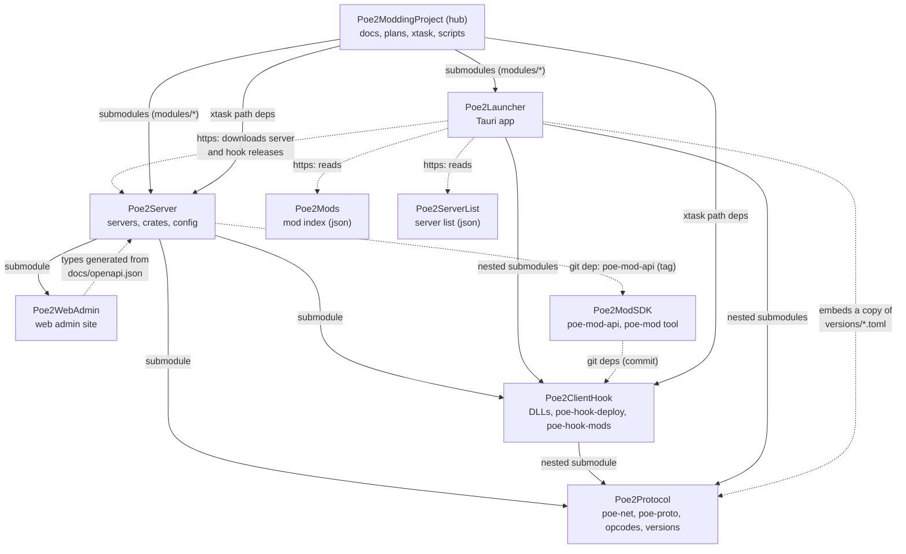

# Project overview

The Path of Exile 2 (client 0.5.5e) private server project is spread over nine repositories under [`Distorbed678`](https://github.com/Distorbed678). This page says which repository does what, how they depend on each other, where the releases are, and how a player, a host and a developer get started. The rules for working on all of them are in [../CLAUDE.md](../CLAUDE.md).

## The repositories

| Repository | Where in the hub | What it is |
|---|---|---|
| [**Poe2ModdingProject**](https://github.com/Distorbed678/Poe2ModdingProject) (the hub, this repo) | `/` | Documentation, plans, reverse-engineering notes and scripts, the dev tooling (`xtask`: deploy the client hook, build the DLLs, `check-build`, tracker, run the server from the hub), the progress tracker, news. Has every other repository as a submodule under `modules/`. No releases. |
| [**Poe2Server**](https://github.com/Distorbed678/Poe2Server) | `modules/server` | The server: login server, instance server, web API, accounts, terrain generator, mod host, config. Builds and tests on its own. Releases `server-v*`. |
| [**Poe2Protocol**](https://github.com/Distorbed678/Poe2Protocol) | `modules/protocol` | The wire protocol crates (`poe-net`, `poe-proto`), the opcode tables `opcodes/<version>/` and the supported-build definitions `versions/<version>.toml`. Used by the server, the client hook and (through the hook) the launcher. |
| [**Poe2ClientHook**](https://github.com/Distorbed678/Poe2ClientHook) | `modules/client-hook` | The client DLLs (loader, debug core with overlay, mod loader), the signature table, `poe-hook-deploy`, and `poe-hook-mods` (mod manifest and packages, shared with the launcher, the server and the SDK). Releases `hook-v*`. |
| [**Poe2WebAdmin**](https://github.com/Distorbed678/Poe2WebAdmin) | `modules/web-admin` | The web admin site (Svelte 5), served by the server and packaged in its releases. |
| [**Poe2Launcher**](https://github.com/Distorbed678/Poe2Launcher) | `modules/launcher` | The player and host launcher (Tauri 2): installs the client from Steam depots, deploys the hook, signs in, starts the game, hosts a server from a server release, manages mods. Releases `v*` (signed auto-update). |
| [**Poe2ModSDK**](https://github.com/Distorbed678/Poe2ModSDK) | `modules/mod-sdk` | The SDK for mod authors: the server mod C ABI (`poe-mod-api`), safe wrappers, the `poe-mod` tool (new, pack, verify), examples. Releases `v*`. |
| [**Poe2Mods**](https://github.com/Distorbed678/Poe2Mods) | `modules/mod-index` | The public mod index (`index.json`, schema, validator, CI). The launcher's mod browser reads it. |
| [**Poe2ServerList**](https://github.com/Distorbed678/Poe2ServerList) | `modules/server-list` | The public server list (`servers.json`, schema, validator, CI). The launcher's server browser reads it. |

## How they depend on each other



Solid arrows are build-time dependencies (git submodules and path dependencies), dotted arrows are pinned git dependencies, generated or copied files, and runtime downloads. Every repository builds on its own after `git clone --recursive`; the hub is only needed for the docs, the plans and the client tooling.

The same text as a list:

- **Poe2Protocol** depends on nothing. It also holds `versions/<version>.toml`, the single definition of a supported client build (depots, exe fingerprint, opcode folder, signature table, accepted client hashes, data anchors).
- **Poe2ClientHook** nests Poe2Protocol (`modules/client-hook/protocol`).
- **Poe2Server** has Poe2Protocol, Poe2ClientHook (for `poe-hook-shared` and `poe-hook-mods`) and Poe2WebAdmin as submodules, and the SDK's `poe-mod-api` crate as a git dependency pinned by tag.
- **Poe2Launcher** nests Poe2ClientHook and Poe2Protocol, embeds a copy of the version files (`cargo xtask versions` keeps it in step), and talks to servers through their web API.
- **Poe2WebAdmin**'s API types are generated from the server's `docs/openapi.json` (`npm run gen:api`); the file is committed in both repositories.
- **Poe2ModSDK** takes the manifest parser and the client ABI crate from Poe2ClientHook as git dependencies pinned to a commit.
- **The hub** has everything as a submodule; its `xtask` uses the server's crates (`poe-config`, `poe-data`, `poe-world`, `poe-proto` from the server's nested protocol checkout) and the hook's `poe-hook-deploy` and `poe-hook-sig` as path dependencies.

A change that spans repositories is committed bottom-up: inside the submodule first (commit and push), then the pointer in the repository above ([../CONTRIBUTING.md](../CONTRIBUTING.md#submodules)).

## Releases

| What | Repository | Tag | Contents | How |
|---|---|---|---|---|
| Server | Poe2Server | `server-v<version>` | `poe-server` for Linux and Windows with the example config, version files, opcode tables, the data schema and the web admin; SHA-256 sums | [releasing.md](../modules/server/docs/releasing.md) |
| Launcher | Poe2Launcher | `v<version>` | Installers for Linux and Windows, signed update manifest | [guides/launcher.md](guides/launcher.md#releasing) |
| Client hook | Poe2ClientHook | `hook-v<version>` | The DLLs, their `poe-hook.toml`, `release.json` (what the launcher checks) | [guides/releasing-hook.md](guides/releasing-hook.md) |
| SDK | Poe2ModSDK | `v<version>` | The `poe-mod` tool and crates for mod authors | the SDK's README |

The server releases `server-v0.1.0` and `server-v0.2.0` were made in this repository before the server moved to Poe2Server; they stay here.

## Getting started

- **Player.** Install the [launcher](https://github.com/Distorbed678/Poe2Launcher/releases) and follow [guides/client.md](guides/client.md): it installs the 0.5.5e client from Steam depots, deploys the hook, signs in to a server from the server list or an address, and starts the game.
- **Host.** Either the launcher's *Host a server* page (it downloads the server release matching your client build and runs it), or a [server release](https://github.com/Distorbed678/Poe2Server/releases) by hand: [hosting.md](../modules/server/docs/hosting.md). Mods for a server: [guides/modding.md](guides/modding.md).
- **Developer.** Clone everything and build:

  ```sh
  git clone --recursive https://github.com/Distorbed678/Poe2ModdingProject.git
  cd Poe2ModdingProject
  third_party/fetch-tools.sh        # external tools, pinned (cargo-xwin, schema, Python env, ...)
  cargo build                       # xtask
  cargo xtask server build          # the server (modules/server)
  cargo xtask server run            # run it from the hub (config modules/server/config/server.toml)
  cargo xtask build-dll             # the client DLLs (modules/client-hook)
  python3 scripts/check-links.py    # the docs' links
  ```

  The server alone needs no hub: `git clone --recursive https://github.com/Distorbed678/Poe2Server && cd Poe2Server && cargo build && cargo test`. Details: [guides/setup.md](guides/setup.md); where the server runs from and which web admin it serves: [guides/setup.md#run](guides/setup.md#run).

## Which folder holds what

| Need | Look in |
|---|---|
| Rules, roadmap | [../CLAUDE.md](../CLAUDE.md), [../README.md](../README.md) (tracker) |
| Server config, crates, servers | `modules/server/` ([architecture/crates.md](architecture/crates.md)) |
| Opcodes, supported builds | `modules/protocol/opcodes/<version>/`, `modules/protocol/versions/<version>.toml` |
| Client DLLs, signatures | `modules/client-hook/` ([architecture/client-dll.md](architecture/client-dll.md)) |
| Datamined outputs, runtime data, the client copy | `dumps/<version>/`, `runtime/`, `GameFiles/` (all git-ignored, in the hub) |
